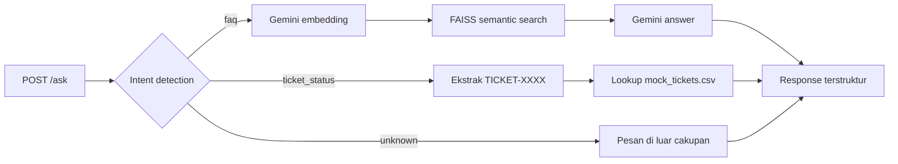

# IT Helpdesk Assistant

Prototype backend API yang menjawab pertanyaan kebijakan internal melalui
Retrieval-Augmented Generation (RAG) dan mengecek status tiket melalui tool call.
Aplikasi menggunakan FastAPI, FAISS, Gemini API, dan dapat dijalankan di Docker.

## Objective dan cakupan

Aplikasi membantu tim People & IT Operations menangani dua jenis permintaan:

1. **FAQ** — pertanyaan informasi atau kebijakan, misalnya "Berapa jatah cuti
   tahunan?". Router mengarahkannya ke semantic search pada knowledge base,
   kemudian Gemini menyusun jawaban hanya dari konteks hasil retrieval.
2. **Status tiket** — permintaan data spesifik, misalnya "Cek status
   TICKET-0005". Router mengekstrak ID dan mengambil data langsung dari CSV tiket.

Query yang tidak berkaitan dengan domain helpdesk dikembalikan sebagai intent
`unknown`. Sistem ini memakai dataset CSV yang disediakan, satu API key Gemini,
dan tidak mengubah isi knowledge base maupun data tiket.

## Workflow



Intent `ticket_status` dipilih jika query berisi ID `TICKET-XXXX` atau meminta
pengecekan status/progres tiket. Intent `faq` dipilih untuk kata kunci domain
knowledge base seperti cuti, password, VPN, perangkat, onboarding, payroll, dan
kebijakan kerja. Query lainnya menjadi `unknown`.

## Struktur project

```text
app/
├── main.py       # FastAPI, validasi request, dan error handling
├── router.py     # Intent detection, ekstraksi ID, dan routing
├── rag.py        # Gemini embedding, FAISS search, dan answer generation
└── tools.py      # Lookup status tiket
data/
├── it_helpdesk_knowledge_base.csv
└── mock_tickets.csv
tests/
└── test_app.py
```

## Menjalankan secara lokal

Gunakan Python 3.11 atau lebih baru.

```bash
python -m venv .venv
source .venv/bin/activate
pip install -r requirements.txt
cp .env.example .env
```

Isi `.env` dengan API key milik sendiri:

```dotenv
GEMINI_API_KEY=your_gemini_api_key_here
```

Aplikasi membaca `.env` di root project. Nilai dalam file ini diutamakan jika
variabel yang sama sudah tersedia di environment sesi. Pada Docker, nilai file
tersebut dimasukkan ke environment container melalui `--env-file .env`.

Jalankan API:

```bash
uvicorn app.main:app --reload
```

Dokumentasi interaktif tersedia di `http://localhost:8000/docs`. Health check
tersedia di `GET /health`.

Contoh request:

```bash
curl -X POST http://localhost:8000/ask \
  -H "Content-Type: application/json" \
  -d '{"query":"Tolong cek status TICKET-0005"}'
```

Response selalu memiliki bentuk berikut:

```json
{
  "status": "success",
  "intent": "ticket_status",
  "data": "TICKET-0005 — Reset password VPN gagal terus. Status: Diproses. Terakhir diperbarui: 2026-08-27."
}
```

## Menjalankan dengan Docker

```bash
docker build -t it-helpdesk-assistant .
docker run --rm -p 8000:8000 --env-file .env it-helpdesk-assistant
```

API dapat diakses dari host melalui `http://localhost:8000`.

## Pengujian

Jalankan automated test tanpa memakai Gemini API:

```bash
python -m unittest discover -s tests -v
```

Tujuh automated test mencakup routing seluruh 31 pertanyaan knowledge base serta
pembuatan index dan pencarian FAISS menggunakan embedding buatan, sehingga tidak
memerlukan API key. Pertanyaan komunikasi internal juga tercakup untuk mencegah
regresi router yang sebelumnya mengembalikan intent `unknown`.

Enam skenario berikut diuji melalui endpoint `/ask` pada 2 November 2026 dengan
Gemini API aktif. Seluruh request menerima HTTP 200 dan diarahkan sesuai harapan.

| Query | Status / intent | Observasi |
|---|---|---|
| Berapa jatah cuti tahunan karyawan tetap? | `success / faq` | RAG menjawab 12 hari dan syarat masa kerja 3 bulan. |
| Bagaimana cara reset password VPN perusahaan? | `success / faq` | RAG menjawab melalui portal self-service atau IT Support. |
| Tolong cek status TICKET-0005 | `success / ticket_status` | Tool menemukan status `Diproses`. |
| Cek status TICKET-9999 | `success / ticket_status` | Tool menangani tiket yang tidak ada tanpa crash. |
| Bagaimana cuaca Jakarta hari ini? | `error / unknown` | Router menolak query di luar cakupan. |
| Aplikasi apa yang digunakan untuk komunikasi internal tim? | `success / faq` | RAG menjawab Slack untuk komunikasi dan Google Meet untuk pertemuan virtual. |

Image Docker `it-helpdesk-assistant:assignment` juga berhasil dibangun. Health
check dan seluruh enam skenario di atas berhasil dijalankan dari container.

## Keterbatasan

- Intent detection masih berbasis keyword sehingga variasi kalimat yang tidak
  memuat kata kunci domain dapat menjadi `unknown`.
- Index FAISS disimpan di memori dan dibangun pada query FAQ pertama setiap kali
  proses aplikasi dimulai.
- Data tiket berasal dari CSV statis dan prototype belum memiliki autentikasi
  atau pemeriksaan kepemilikan tiket.
- Jalur FAQ memerlukan koneksi internet, API key yang valid, dan ketersediaan
  layanan Gemini. Kegagalan layanan dikembalikan sebagai response error yang aman.
